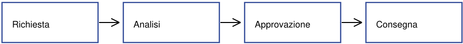
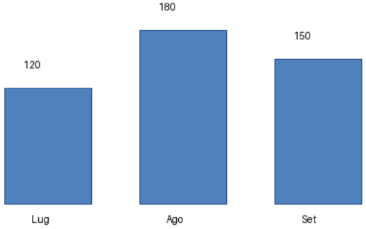

# Report Trimestrale - Q3 2026

Andamento vendite e flusso operativo

Nel terzo trimestre le vendite sono cresciute del 12% rispetto al periodo precedente. La tabella riporta il dettaglio per regione, mentre il diagramma mostra il flusso di approvazione degli ordini.

<table><tr><td>Regione</td><td>Unita vendute</td><td>Ricavo (EUR)</td></tr><tr><td>Nord</td><td>120</td><td>45.000</td></tr><tr><td>Centro</td><td>80</td><td>30.500</td></tr><tr><td>Sud</td><td>60</td><td>22.000</td></tr></table>

## Diagramma di flusso (dal diagramma)

*Pipeline: Acquisizione -> Estrazione -> Validazione -> Archivio*

## Diagramma di flusso (ricostruito da frecce riconosciute)

